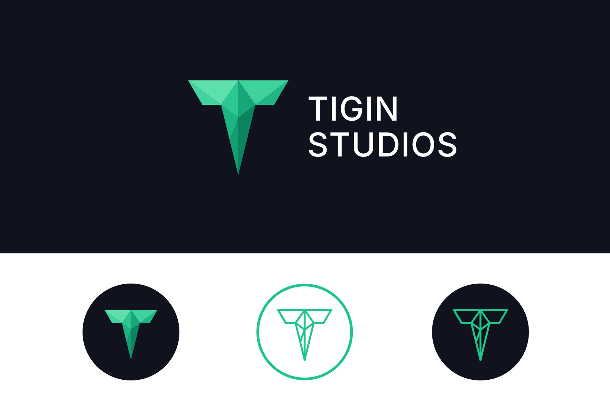

# Tigin Studios Branding

Official logo, icon and avatar assets for Tigin Studios.

## Assets

### Logo

| File | Size | Use on |
| --- | --- | --- |
| `logo/logo-horizontal-dark.svg` / `.png` | 1240 × 480 | dark backgrounds |
| `logo/logo-horizontal-light.svg` / `.png` | 1240 × 480 | light backgrounds |
| `logo/logo-sheet.svg` / `.png` | 1700 × 1134 | overview of all variants |

### Icon

| File | Size | Style |
| --- | --- | --- |
| `icon/icon-filled-dark.svg` / `.png` | 512 × 512 | filled mark on dark circle |
| `icon/icon-outline-dark.svg` / `.png` | 512 × 512 | outline mark on dark circle |
| `icon/icon-outline-light.svg` / `.png` | 512 × 512 | outline mark on light circle |

### Discord

| File | Size | Notes |
| --- | --- | --- |
| `discord/discord-pfp.gif` | 512 × 512 | animated profile picture |
| `discord/discord-pfp-static.png` | 512 × 512 | static fallback |

Prefer the SVG files whenever the target supports them. The PNG exports are there for places that don't.

## Colors

| Name | Hex |
| --- | --- |
| Background | `#10121E` |
| Primary green | `#1FC58A` |
| Light green | `#5EE0AD` |
| Dark green | `#0B8460` |
| Text on dark | `#FFFFFF` |

## Typography

The wordmark uses **Inter**, falling back to Montserrat and Arial.

## License

All rights reserved. See [LICENSE](LICENSE).
